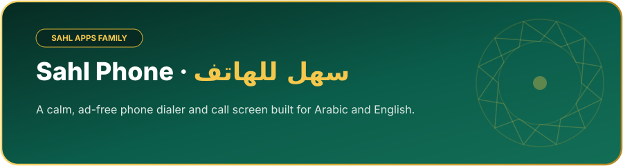

  

---

## ✨ Highlights

| Feature | What it gives you |
|---|---|
| 📞 **Smart T9 Keypad** | Find contacts instantly by dialing numbers or typing names in Arabic or English. |
| 📋 **Grouped Recent Calls** | Clear color-coded call history for missed, incoming, and outgoing calls with quick actions. |
| 🔇 **Sahl Call Screen & Dual-SIM** | Clean incoming & active call screens with speaker, Bluetooth, mute, hold, and dual-SIM selection. |
| 🤝 **Sahl Union Integration** | Works seamlessly with Sahl Contacts for caller names and Sahl Tools Call Guard for spam protection. |

---

## 📲 Install in Seconds

1. Tap **[Download Latest APK](https://github.com/AliSherif1309/SahlPhone/releases/latest)** above.
2. Open the downloaded `.apk` file on your Android phone to install.
3. **Sahl Phone** checks for new versions automatically so you stay up to date in one tap.

---

## 🌿 The Sahl Apps Family · عائلة تطبيقات سهل

A calm, ad-free, bilingual (**Arabic & English**) suite of everyday Android apps crafted in **Emerald & Gold**:

[🎨 Sahl Theme](https://github.com/AliSherif1309/SahlHome) · [🕌 Sahl Adhan](https://github.com/AliSherif1309/SahlAdhan) · [🧭 Sahl Qibla](https://github.com/AliSherif1309/SahlQibla) · [👤 Sahl Contacts](https://github.com/AliSherif1309/SahlContacts) · [💬 Sahl Messages](https://github.com/AliSherif1309/SahlMessages) · [📷 Sahl Camera](https://github.com/AliSherif1309/SahlCamera) · [🖼️ Sahl Gallery](https://github.com/AliSherif1309/SahlGallery) · [📁 Sahl Files](https://github.com/AliSherif1309/SahlFiles) · [📄 Sahl PDF](https://github.com/AliSherif1309/SahlPDF) · [🛠️ Sahl Tools](https://github.com/AliSherif1309/SahlTools) · [☁️ Sahl Sync](https://github.com/AliSherif1309/SahlSync) · [📺 Sahl TV](https://github.com/AliSherif1309/SahlTV-Launcher)
